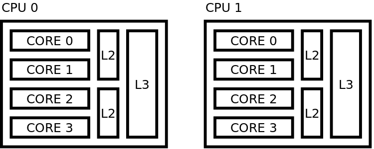

.. _threads:

Threading
=========

The smallest unit of executable program is known as a thread.

We can adjust the number of :ref:`MPI processes <mpi_process>` and threads, but the product of the two should ideally be the total number of cores.
For example, with 8 cores, we can have 2 processes and 4 threads per process or 1 process with 8 threads.
In NEST, we recommend only having one thread per core.

We can control the number and placement of threads with programs that implement standards such as `OpenMP <https://www.openmp.org/>`_.

For a detailed investigation, we recommend reading Kurth et al. 2022 :footcite:p:`Kurth2022`.

.. seealso::

    * :ref:`overview_hardware`
    * :ref:`mpi_process`
    * :ref:`slurm_script`
    * :ref:`simulation_limits`: Maximum threads, MPI ranks, synapse types, and delay bounds

.. _pinning_threads:

Pinning threads
---------------

Pinning threads allows you to control the distribution of threads across available cores on your system, and is particularly
useful in high performance computing (HPC) systems.

Allowing threads to move can be beneficial in some cases. But when threads move, the data that is to be processed needs to move too.
With NEST, each thread gets allocated a specific set of data objects to work with during simulation (due to the round robin distribution).
This means that when a thread moves, it cannot perform any computation until its specific data gets to the right place.
This is called *cache misses*. For this reason, pinning threads typically decreases run time.
See our overview :ref:`handling threads with virtual processes <sec_virt_proc>`.

There are different types of pinning schemes, and the optimal scheme will depend on your script.
Here we show two different example schemes.


Sequential pinning scheme
`````````````````````````



   Sequential placing

   In this scheme, the cores of 1 CPU are filled before going to next

   Setting to use for this case: ``export OMP_PROC_BIND = close``

Distant pinning scheme
``````````````````````


   Distant placing

   Maximizes distance between threads in hardware

   Setting to use for this case: ``export OMP_PROC_BIND = spread``


Table of OpenMP settings
````````````````````````

.. list-table:: OpenMP settings
   :header-rows: 1

   * - Setting
     - Description
   * - ``export OMP_NUM_THREADS=#CPUSPERTASK#``
     - variable telling OpenMP how many threads are used on a MPI process
   * - ``export OMP_PROC_BIND=true``
     - no movement of threads between OpenMP threads and OpenMP places
   * - ``export OMP_PROC_BIND=close/spread``
     - no movement of threads between OpenMP threads and OpenMP places and OpenMP places are 'close' in a hardware sense
   * - ``export OMP_PLACES=threads/cores``
     - each OpenMP place corresponds to a hardware thread/core
   * - ``export OMP_PLACES="{a : b : c}"``
     - OpenMP places are a, a+b, a+2c, ... a+nc=b (numbering usually relates to cores/hardware threads)
   * - ``export OMP_DISPLAY_ENV=true``
     - display OpenMP variables

.. _many_threads:

Settings for many threads per process
`````````````````````````````````````

In every simulation cycle, all threads of a process meet at barriers, and the spikes of all threads are collected and
exchanged. With a few threads per process this takes little time. With many threads per process, and in particular when
the threads of one process run on several sockets or chips, these steps become a large part of the cycle. The following
kernel parameters reduce this part. They do not change the results of a simulation, only how fast it runs. All of them
are off by default (``False`` or 1); whether they pay off depends on the model and the system, so compare the run times.

All of them assume that every thread has a core of its own and that the threads are bound to their cores
(``OMP_PROC_BIND`` and ``OMP_PLACES``, see above).

``tree_barrier``
   Replaces the OpenMP barriers of the simulation loop by a barrier in which the threads arrive in small groups, like the
   branches of a tree, and wait by spinning instead of sleeping. Do not use it when there are more threads than cores,
   since a spinning thread then takes the core away from a thread that has work to do.

   ``tree_barrier_fan_in`` sets the size of the groups. Set it to the number of cores that share a last-level cache,
   for example 8 for the core complexes of AMD EPYC processors. How to find this number depends on the system. On many
   Linux systems, ``lscpu --caches`` gives the size of one cache of each level and of all caches of that level together
   (for the L3 of a node with 256 cores, for example, 16 MB and 512 MB: 32 caches, so 8 cores per cache), and a modern
   Linux system may expose the cores that share the last-level cache with core 0 at a location like
   ``/sys/devices/system/cpu/cpu0/cache/index3/shared_cpu_list``. Where all cores of a socket share one cache, or where
   this information is not available, keep the default of 8: larger groups make the tree shallower, but more threads
   then write the same counter.

``single_cycle_barrier``
   With ``tree_barrier``, completes a simulation cycle with one barrier instead of two: the work between the two
   barriers is done while the threads arrive, by the last thread of each group and by the master thread. It pays off
   where a barrier is expensive compared to the cycle: many threads per process, several sockets or chips per process,
   short cycles.

``collocation_groups``
   Divides the threads into this many groups, which collect the spikes of their threads in parallel instead of the master
   thread alone. Set it to the number of sockets or NUMA nodes used by the process.

``compressed_spike_data_copies``
   Gives each block of threads its own copy of the table that the threads read for every spike they deliver, so that the
   threads of a socket read local memory. Set it to the number of sockets or NUMA nodes used by the process. Each copy
   needs additional memory.

With bound threads, NEST forms the groups and blocks along the NUMA nodes of the threads (see below). An example for one
process with 128 threads on a node with two sockets of 64 cores each:

.. code-block:: bash

   export OMP_NUM_THREADS=128
   export OMP_PROC_BIND=close
   export OMP_PLACES=cores

.. code-block:: python

   nest.set(
       local_num_threads=128,
       tree_barrier=True,
       single_cycle_barrier=True,
       collocation_groups=2,
       compressed_spike_data_copies=2,
   )

With one process per socket instead, each process uses one socket, and ``collocation_groups`` and
``compressed_spike_data_copies`` stay at 1.

.. _one_core_free:

Leaving one core to the operating system
````````````````````````````````````````

The operating system handles most of its background work, such as interrupts and system services, on the first core of a
node. A thread of NEST on that core is delayed now and then, and since all threads meet at the end of every simulation cycle,
the other threads wait for it. Leaving this core free and running one thread fewer can therefore make a simulation faster,
in particular with many threads per process and short simulation cycles. Whether it does depends on the system, so compare
the run times with and without.

To leave core 0 free, list the places of the threads explicitly. For one process on a node with two sockets of 64 cores
each (cores 0-63 and 64-127):

.. code-block:: bash

   export OMP_NUM_THREADS=127
   export OMP_PROC_BIND=close
   export OMP_PLACES="{1}:63,{64}:64"

and set ``nest.local_num_threads = 127`` in your script. ``{1}:63`` means 63 places starting at core 1, ``{64}:64`` the 64
cores of the second socket. Run ``lscpu`` to see how the cores of your node are numbered and which cores belong to which
socket or NUMA node. With Slurm, request all cores of the node (``--cpus-per-task=128``) and let OpenMP place the threads
(``srun --cpu-bind=none``), so that the places above are not restricted by Slurm.

When the threads are bound to places in this way, NEST forms its blocks of threads (``collocation_groups``,
``compressed_spike_data_copies``) along the NUMA nodes of the threads, so that a block does not span two nodes even if the
nodes run different numbers of threads.

.. note::

   Using ```python``` on HPC systems might lead to inconsistencies in multi-threading libraries resulting in a degredation of performance.
   For instance, depending on the installation ```numpy``` uses the multi-threading library provided by the MKL.
   To resolve this one needs to set ```export MKL_THREADING_LAYER=GNU``` in order to pass the OpenMP settings correctly.


.. seealso::

   For general details on pinning in HPC systems see `the HPC wiki article <https://hpc-wiki.info/hpc/Binding/Pinning>`_.


References
----------

.. footbibliography::
